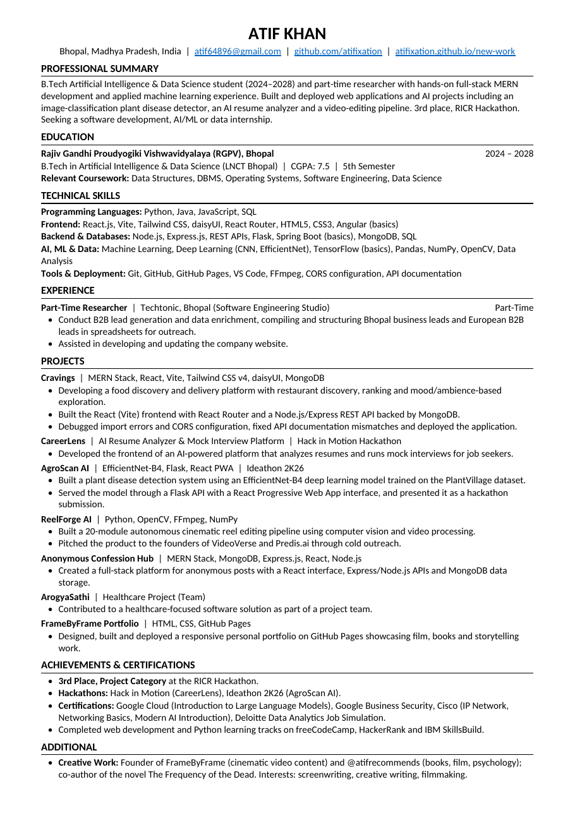

📧 [Email](mailto:atif64896@gmail.com) &nbsp;·&nbsp; 📄 [Resume](./Atif_Khan_Resume%20.pdf) &nbsp;·&nbsp; 🌐 [Portfolio](https://atifixation.github.io/new-work) &nbsp;·&nbsp; 📍 Bhopal, India

## `whoami`

I'm Atif Khan, a 5th-semester B.Tech student in Artificial Intelligence & Data Science at RGPV, Bhopal, and a part-time researcher at **Techtonic**, a software engineering studio. I build full-stack apps with the **MERN stack** and train deep learning models for practical AI applications.

I also write screenplays and creative fiction. That side of me shapes how I approach software: understand the problem, think through the user's journey, and make the final experience feel intentional.

**Current focus:** full-stack web development, AI-powered products, and internship opportunities in software, AI/ML and data roles.

## 💼 Experience

**Part-Time Researcher · Techtonic, Bhopal**
- B2B lead generation and data enrichment: structured Bhopal business leads and European B2B leads for outreach.
- Assisted with the company website.

## ⚙️ Tech stack

  

  <b>Languages:</b> Python · Java · JavaScript · SQL 
  <b>Frontend:</b> React · Vite · Tailwind CSS · React Router · HTML · CSS 
  <b>Backend & databases:</b> Node.js · Express.js · Flask · REST APIs · MongoDB · PostgreSQL 
  <b>AI & data:</b> Machine Learning · Deep Learning (EfficientNet) · TensorFlow · OpenCV · Pandas · NumPy 
  <b>Tools:</b> Git · GitHub · GitHub Pages · FFmpeg · VS Code

## 🚀 Featured work

<b>🍽️ Cravings — Food discovery & delivery platform</b>

 

A food platform designed to go beyond a basic delivery interface, combining restaurant discovery with ranking and mood/ambience-based exploration. Built with a React (Vite) frontend, a Node.js/Express REST API and MongoDB.

**Focus:** user experience, component-based UI, API integration (CORS, documentation) and deployment.

`React` `Vite` `Tailwind CSS` `Node.js` `Express.js` `MongoDB`

<b>🌿 AgroScan AI — Plant disease detection</b>

 

A plant disease detection system using an **EfficientNet-B4** model trained on the PlantVillage dataset, served through a Flask API with a React Progressive Web App interface. Presented at Ideathon 2K26.

`Python` `EfficientNet-B4` `Flask` `React` `PWA`

<b>🩺 ArogyaSathi — Community healthcare workflow</b>

 

A healthcare-focused application built around a workflow connecting **citizens, ASHA workers, and health officers**. The project uses a React + Vite frontend, a REST API with Node.js/Express, and PostgreSQL for data storage.

**Focus:** role-based workflows, structured health-service coordination, and full-stack integration.

`React` `Vite` `Node.js` `Express.js` `REST API` `PostgreSQL`

<b>🎯 CareerLens — AI resume analyzer & mock interviews</b>

 

An AI-powered platform that analyzes resumes and runs mock interviews, built for the Hack in Motion hackathon. I developed the frontend.

`React` `AI`

<b>🎞️ ReelForge AI — Autonomous cinematic reel editor</b>

 

A 20-module video editing pipeline built with computer vision and video processing, pitched to the founders of VideoVerse and Predis.ai.

`Python` `OpenCV` `FFmpeg` `NumPy`

<b>🔐 Anonymous Confession Hub — Full-stack web app</b>

 

A web platform for publishing anonymous posts, with a React frontend and a Node/Express API backed by MongoDB.

`MongoDB` `Express.js` `React` `Node.js`

<b>🎬 FrameByFrame — Portfolio & creative brand</b>

 

A personal creative presence for cinematic content and storytelling, combining web publishing with interests in film, books, and visual narratives.

`HTML` `CSS` `GitHub Pages`

## 📈 2026 activity

 

 

## 🥉 Recognition & certifications

- **3rd Rank, Project Category — RICR Hackathon**
- **Hackathons:** Hack in Motion (CareerLens) · Ideathon 2K26 (AgroScan AI)
- **Certifications:** Google Cloud (Intro to Large Language Models) · Google Business Security · Cisco (IP Network, Networking Basics, Modern AI Introduction) · Deloitte Data Analytics Job Simulation

## 📄 Resume

  

## 🎬 Beyond code

- **Writing:** screenwriting and creative fiction, including the co-authored novel *The Frequency of the Dead*.
- **Film:** FrameByFrame, cinematic storytelling, editing, and visual content.
- **Reading:** @atifrecommends, my content on books, film and psychology.

## 📡 Connect

  

*“Build things that hold up, even when nobody is watching.”*

